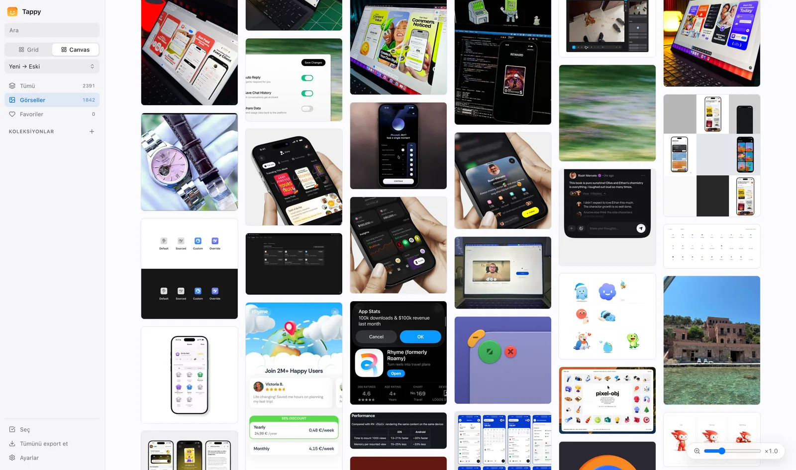
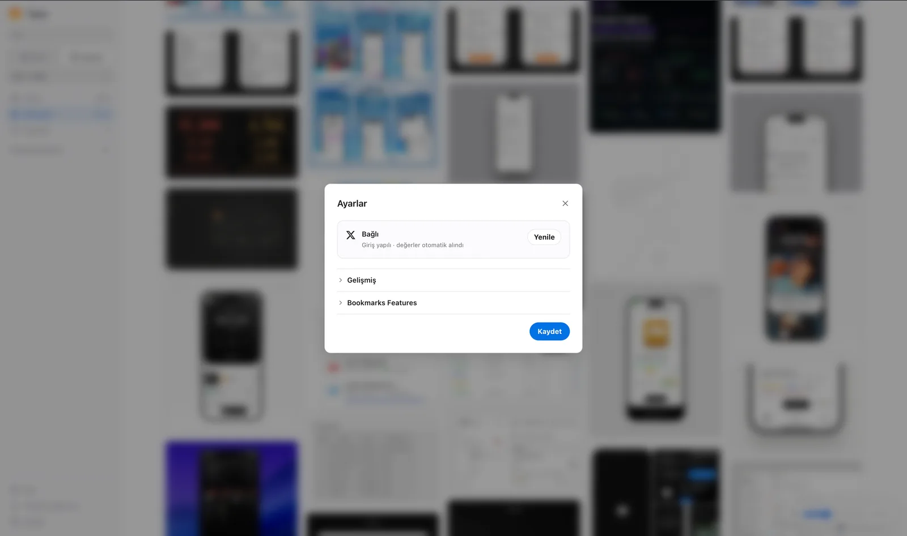

# Tappy

A Chrome (MV3) extension for browsing, organizing, and exporting your X (Twitter) bookmarks on an infinite, zoomable canvas. Image-first, fully local, warm and minimal UI.

> Your bookmarks are read and stored entirely on your device, using your own browser session. No third-party server is involved.



## Highlights

- **Infinite canvas** — free pan, pointer-anchored zoom, and an organic scatter layout. No pages, no bounds.
- **Image-first cards** — knowspace-style white cards with tweet text, author, likes, and carousel badges for multi-image posts.
- **Bottom dock** — search, a filter panel, and **Şaşırt beni** (surprise me), which flies to a random bookmark.
- **Lightbox** — full-screen image growing out of the clicked tile, right-hand action bar, bottom strip for multi-image tweets, arrow-key navigation.
- **Collections** — named collections (create / rename / delete), per-collection color, single and bulk add, plus a non-deletable `Favoriler`.
- **Search & sort** — search by text / author / handle; combine author, inclusive local publication-date range, image presence, and minimum likes. Filters and sort apply to locally loaded records, and work inside collections.
- **Export** — all or selected records as **JSON** / **CSV**; selected images as a single **ZIP** to drag into Figma; copy or download an individual image.
- **Unmark** — remove a bookmark from the lightbox, or several at once from the selection bar, with 5 seconds to undo.
- **Grid** — a newest-first list with bookmark dates, next to the infinite canvas.

## Install

1. Download **`tappy-0.2.0-chrome.zip`** from the [latest release](https://github.com/cemtatli/tappy/releases/latest).
2. Unzip it somewhere permanent — Chrome loads the extension from that folder, so deleting it removes the extension.
3. Open `chrome://extensions` and turn on **Developer mode** (top right).
4. Click **Load unpacked** and select the unzipped folder.
5. Sign in to [x.com](https://x.com) in the same browser, then click the Tappy icon.

Works in Chrome, Edge, Brave and other Chromium browsers. Not on the Chrome Web Store yet, so it will not auto-update — download a newer release to upgrade.

## How it works

The extension reads **your own** bookmarks from X's GraphQL API using the session cookies (`ct0` / `auth_token`) already in your browser. Data is kept in **IndexedDB** (via Dexie) with incremental sync (fetch the newest, page backwards through the older ones). Cookie values never leave the background service worker, and no secrets are bundled with the code.

The X-specific values — bearer token, Bookmarks query ID, Delete Bookmark query ID — are **not hardcoded**. The extension picks them up from your own x.com traffic, or you can paste them in from DevTools. Either way they live in `chrome.storage.local`. X rotates these regularly; when a request starts failing, the extension rediscovers them and retries.

Settings reflects that: a healthy connection shows nothing to configure, and the fields only surface when something needs your attention.



## Tech

Chrome MV3 · React 19 · Dexie · Tailwind 4 (`@theme` tokens) · `@base-ui/react` · `@tanstack/react-virtual` · lucide-react · Vite · Vitest + jsdom + fake-indexeddb.

The UI is currently in Turkish.

## Development

```bash
npm install
npm run build      # vite build + copy static files → dist/
npm test           # Vitest suite
npm run lint       # ESLint
npm run format     # Prettier
npm run package:release # build + validated ZIP and SHA256SUMS.txt → releases/<version>/
```

### Packaging a release

Run `npm ci`, `npm test`, `npm run lint`, then `npm run package:release`.
Packaging requires the `zip` and `unzip` command-line tools. It checks that package and manifest versions match, validates the extension entry points, and includes installation instructions and the MIT license. Only the production extension files are archived; dependencies, tests, and local bookmark data are excluded.

The output directory must be new: existing release artifacts are never overwritten. Upload the ZIP and `SHA256SUMS.txt` from `releases/<version>/` together. On macOS or Linux, run `shasum -a 256 -c SHA256SUMS.txt` in the download folder to verify the ZIP.

### Loading a local build

1. Run `npm run build` to produce `dist/`.
2. Open `chrome://extensions` and enable **Developer mode**.
3. Choose **Load unpacked** and select the `dist/` folder.

## Security

Hardening for public release: MV3 `content_security_policy` allowlist, sandboxed tweet-embed iframe, no bundled secrets, no `dangerouslySetInnerHTML` or `eval`, `rel="noreferrer"` on external links.

## License

[MIT](LICENSE)
